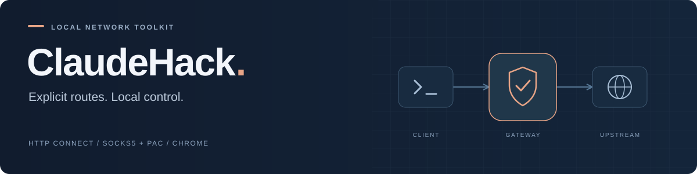
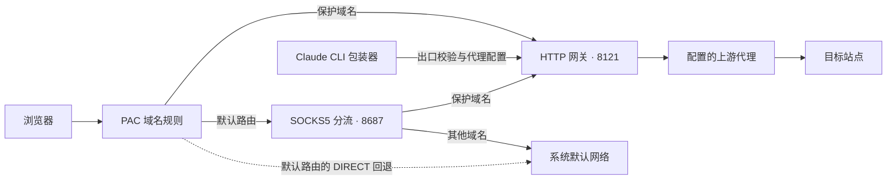

<div align="center">



**面向 macOS 的本地代理与域名分流工具集**

让指定站点使用明确的代理出口，让日常流量继续遵循原有网络设置。


[安装方式](#安装方式) · [工作原理](#工作原理) · [快速开始](#快速开始) · [项目结构](#项目结构) · [验证与测试](#验证与测试) · [能力边界](#能力边界)

</div>

---

## 项目概览

ClaudeHack 将 **HTTP CONNECT 网关、SOCKS5 分流、PAC、Chrome 扩展与 CLI 出口校验** 组合为一套可检查、可维护的本地网络工具。适用于需要为 Claude 及相关站点配置固定代理出口，同时保留日常网络使用方式的 macOS 环境。

仓库提供源码、配置示例、服务模板与离线回归测试。实际代理凭据、账号资料、浏览器用户数据和运行日志均不包含在仓库中。

| 能力 | 实现方式 |
| :--- | :--- |
| **按域名分流** | PAC 与 SOCKS5 分流器使用 78 个保护域名后缀、10 个豁免子域 |
| **代理失败时拒绝请求** | 命中保护名单的 PAC 结果不含 `DIRECT`；网关配置无效时拒绝新连接 |
| **连接重试与清理** | 错峰并发、渐进退避，并处理超时后的迟到连接和转发失败资源回收 |
| **浏览器环境设置** | Chrome 扩展在匹配页面调整语言并限制非代理 WebRTC UDP；时间接口保持浏览器原生行为 |
| **CLI 启动校验** | 启动前检查实际出口，注入代理环境变量，提供独立配置目录入口 |
| **macOS 常驻运行** | 提供 launchd 模板及由 root 管理的代理守护程序部署方案 |

## 安装方式

**这是包含 Chrome 插件的源码项目。** 你可以只安装插件，也可以在 macOS 上部署完整代理环境。当前没有一键安装器，下载 ZIP 本身不会启动代理服务。

| 你的目标 | 应该怎么安装 | 需要什么 |
| :--- | :--- | :--- |
| 只使用插件的网页语言和 WebRTC 设置 | 按下方 **A：只安装 Chrome 插件** 加载 `extension` 文件夹 | Chrome；无需 Python 或运行代理服务 |
| 使用本项目的指定代理出口和域名分流 | 按 **B：完整代理环境** 部署服务、填写上游配置并设置 PAC；插件按 A 单独加载 | macOS、Python、自备可用的上游代理 |
| 已经装好并正常使用 | 继续使用现有环境 | 无需重新安装或重复启动服务 |

**插件不包含住宅 IP，也不负责配置 PAC 或代理。** 只安装插件，网页仍使用浏览器原有网络出口；完整的网络分流需要本地服务与代理配置配合。

## 工作原理



**保护范围由名单决定。** 普通网站及明确豁免的子域继续使用系统默认网络。PAC 服务监听 `127.0.0.1:8899`；三个本地服务均只监听回环地址。

## 快速开始

> [!NOTE]
> 以下步骤用于新环境的手动配置。已有环境运行正常时，无需重复安装或重置浏览器。

### A. 只安装 Chrome 插件

1. 打开 [仓库首页](https://github.com/Rskyss/claudehack)，点击绿色 **Code → Download ZIP**。
2. 解压 ZIP，找到解压目录中的 **`extension` 文件夹**。通常路径为 `claudehack-main/extension/`，里面应直接包含 `manifest.json`。
3. 把解压目录放在你准备长期保留的位置。在要使用插件的 Chrome 配置文件中，打开 `chrome://extensions`。
4. 打开右上角的 **开发者模式**，点击 **加载已解压的扩展程序**。
5. 选择 **`extension` 文件夹**。不要选择 ZIP 文件、整个 `claudehack-main` 项目目录或单独的 `manifest.json` 文件。
6. 确认扩展列表出现 **Claude 美区住宅安全护盾**、版本 **2.3.1**，处于启用状态，且没有加载错误；重新加载希望应用设置的网页。

加载后请保留该文件夹。移动或删除它可能导致扩展无法加载。后续更新文件后，在扩展管理页面点击该扩展的刷新按钮，再刷新目标网页。

这条路线只需安装浏览器插件；下方三个 Python 服务属于完整代理路线，无需为了加载插件而运行。语言等页面注入作用于匹配页面及已实现的 API；日期与时区由浏览器原生接口提供；WebRTC 策略作用于安装扩展的整个 Chrome 配置文件，该配置文件内其他网页也共用这项策略。具体范围见[能力边界](#能力边界)。

### B. 完整代理环境（macOS）

选择这条路线时，先准备可用的上游 HTTP 代理及其凭据。以下命令用于本地代理服务；插件依照 A 路线单独安装。

#### 1. 准备环境

| 依赖 | 用途 |
| :--- | :--- |
| macOS | 运行环境；系统服务模板使用 launchd |
| Python 3.9+ | 运行代理服务与回归测试，无需安装第三方 Python 依赖 |
| Chrome | 使用浏览器扩展时需要 |
| Swift 编译器 | 仅在编译可选的 macOS 代理守护 helper 时需要 |
| Node.js | 仅用于可选的扩展 JavaScript 语法检查 |

```sh
git clone https://github.com/Rskyss/claudehack.git
cd claudehack
```

#### 2. 安装本地文件

```sh
mkdir -p "$HOME/.config/claude-residential/bin"
chmod 700 "$HOME/.config/claude-residential"
cp gateway/*.py gateway/proxy.pac "$HOME/.config/claude-residential/"
cp bin/* "$HOME/.config/claude-residential/bin/"
chmod +x "$HOME/.config/claude-residential/bin/"*

# 配置已存在时保留原文件。
if [ ! -e "$HOME/.config/claude-residential/residential.json" ]; then
  (umask 077; cp config/residential.example.json "$HOME/.config/claude-residential/residential.json")
fi
chmod 600 "$HOME/.config/claude-residential/residential.json"
```

#### 3. 配置上游代理

编辑 `~/.config/claude-residential/residential.json`，填写自己的代理信息。完整示例见 [`residential.example.json`](config/residential.example.json)。

| 字段 | 说明 |
| :--- | :--- |
| `host` / `port` | 上游 HTTP 代理地址与端口 |
| `username` / `password` | 上游代理凭据 |
| `expected_ip` | CLI 启动时要求匹配的公网出口 IP |
| `local_proxy` | CLI 使用的本地代理地址，默认 `http://127.0.0.1:8121` |
| `timezone` / `locale` | 维护记录；扩展不改写日期或时区，语言仍由扩展代码设置；CLI 设置见启动脚本 |
| `expires_at` | 到期日记录，当前不触发自动提醒或按日期拦截 |

示例中的 `203.0.113.10` 是文档专用地址，不能用于真实联网。`0600` 权限限制文件访问，并不代表凭据经过加密。

#### 4. 启动并检查出口

在**三个独立终端**中分别运行以下命令；也可按后文配置 launchd 常驻服务。

```sh
# 终端 A：HTTP / CONNECT 网关
python3 "$HOME/.config/claude-residential/retry_proxy.py"

# 终端 B：SOCKS5 分流
python3 "$HOME/.config/claude-residential/split_proxy.py"

# 终端 C：PAC 服务
python3 "$HOME/.config/claude-residential/pac_server.py"
```

通过网关查询出口，并与自己的 `expected_ip` 对照：

```sh
curl --noproxy '' --proxy http://127.0.0.1:8121 https://api.ipify.org
```

#### 5. 接入浏览器或 CLI

**浏览器**

使用 PAC 地址 `http://127.0.0.1:8899/proxy.pac?v=8`。插件按上面的 A 路线单独加载；加载插件这一步不会自动设置 PAC。

需要强制 PAC 时，由管理员在 Chrome 的 `ProxySettings` 中配置以下字段，并保留已有的其他管理策略：

| 字段 | 值 |
| :--- | :--- |
| `ProxyMode` | `pac_script` |
| `ProxyPacMandatory` | `true` |
| `ProxyPacUrl` | `http://127.0.0.1:8899/proxy.pac?v=8` |

**Claude CLI**

包装器默认调用 `$HOME/.local/bin/claude`。确认底层 CLI 已安装，再把包装器目录放在 PATH 前面：

```sh
export PATH="$HOME/.config/claude-residential/bin:$PATH"
```

`claude-a`、`claude-b` 分别使用独立的 Claude 配置目录。`--help` 与 `--version` 不执行联网检查；回归测试无需安装或登录 Claude。

## 项目结构

| 路径 | 职责 |
| :--- | :--- |
| [`gateway/retry_proxy.py`](gateway/retry_proxy.py) | HTTP / CONNECT 网关，端口 `8121` |
| [`gateway/split_proxy.py`](gateway/split_proxy.py) | SOCKS5 域名分流，端口 `8687` |
| [`gateway/proxy.pac`](gateway/proxy.pac) | 浏览器自动代理规则 |
| [`gateway/pac_server.py`](gateway/pac_server.py) | 本地 PAC 服务，端口 `8899` |
| [`extension/`](extension/) | Chrome 扩展 v2.3.1 |
| [`bin/`](bin/) | Claude CLI 包装器与配置目录入口 |
| [`config/`](config/) | 脱敏配置示例 |
| [`macos/`](macos/) | 守护脚本、Swift helper 源码模板与 launchd 模板 |
| [`tests/`](tests/) | 离线回归测试 |

## macOS 常驻部署

常驻运行使用 [`macos/launchd/`](macos/launchd/) 中的模板。模板需要填写实际路径，仓库不会自动覆盖或启用系统服务。

<details>
<summary><strong>LaunchAgent：以普通用户身份运行三个本地服务</strong></summary>

替换三个 LaunchAgent 模板中的占位符：

| 占位符 | 替换内容 |
| :--- | :--- |
| `__USER_HOME__` | 用户目录的绝对路径 |
| `__PYTHON__` | Python 3.9+ 可执行文件的绝对路径 |

用 `plutil -lint` 检查替换后的 plist，再安装到该用户的 `~/Library/LaunchAgents/`。保持服务以普通用户身份运行。

</details>

<details>
<summary><strong>可选 LaunchDaemon：在系统代理被覆盖时恢复 PAC</strong></summary>

如果已有 VPN 会覆盖系统 PAC，可使用 [`proxy-guard.sh`](macos/proxy-guard.sh) 配合 Swift helper。

1. 替换 [`install-proxy.swift.template`](macos/install-proxy.swift.template) 中的 `__USER_HOME__`，在普通用户权限下编译。
2. 由管理员将脚本和编译结果复制到 `/Library/PrivilegedHelperTools/local.claude-residential/`，不使用指向用户目录的软链接。
3. 安装 [`local.claude-residential-proxy-guard.plist`](macos/launchd/local.claude-residential-proxy-guard.plist)，核对路径并通过 `plutil -lint` 检查后启用。

| 对象 | 所有者 / 权限 |
| :--- | :--- |
| helper 目录、脚本和二进制 | `root:wheel` / `0755`，普通用户不可写 |
| LaunchDaemon plist | `root:wheel` / `0644` |
| `/var/log/claude-residential-proxy-guard.log` | `root:wheel` / `0600` |

helper 从用户目录读取 PAC 作为配置数据，但 root 执行的脚本和二进制必须放在受保护的系统目录。更新 helper 后也应重新由管理员安装。

</details>

## 验证与测试

### 本地复测

完整测试需要 Python 3 和 Node.js 22 或更新版本（日期回归使用 Node 的 Blob / Object URL 与隔离执行环境）。

```sh
# 离线回归测试：不读取真实凭据、不访问外网
PYTHONDONTWRITEBYTECODE=1 python3 -m unittest discover -s tests -v

# 可选语法检查
node --check extension/shield.js
bash -n macos/proxy-guard.sh
```

### 已记录的验收

以下是 **2026-10-31 的本机验证记录**，不是持续集成或实时服务状态。

| 检查 | 结果与范围 |
| :--- | :--- |
| 网关回归测试 | **9 项通过**；覆盖配置异常、热加载、正常隧道、重试上限、迟到连接和异常清理 |
| HTTP / HTTPS 出口 | 临时与正式网关的出口核验通过 |
| Stripe 脚本请求 | HTTP `200` |
| Claude / Persona 命令行探测 | TLS 连接成功，HTTP `403`；仅能确认传输连通，不能视为账号或支付验证通过 |
| root 守护程序 | 可执行文件迁至 root 管理目录，运行状态与权限验收通过 |

<details>
<summary><strong>维护修复记录</strong></summary>

- **配置错误回退**：配置缺失、损坏或必要字段无效时拒绝新连接，移除源码内置备用凭据。
- **连接资源清理**：竞速结束与成功 socket 移交共用锁，避免调用方退出后的迟到连接失去所有者；转发异常时关闭已取得的上游连接。
- **特权执行路径**：root 守护脚本与 helper 迁入 root 管理目录，日志迁至系统日志目录。

本次维护保留原有分流名单、端口、并发数、重试次数、超时参数和扩展行为。公开源码仅将机器路径改为用户目录或模板占位符，并使用示例地址替代实际出口。

</details>

## 能力边界

这套工具解决的是本地路由、配置管理与连接可靠性问题。使用时需要了解以下边界：

- **域名覆盖**：只有已列入名单且实际使用这些代理组件的请求受规则约束。新增第三方域名和银行验证页面不保证覆盖。
- **配置文件隔离**：Chrome 独立配置文件提供存储层面的逻辑隔离，不等于独立硬件或操作系统。
- **Worker 覆盖**：扩展仅对部分非 module 的 blob/data Worker 设置语言，未覆盖外部 URL Worker 和 module Worker；主页面及 Worker 的 Date / Intl.DateTimeFormat 均保持原生。
- **CLI 隔离**：启动前出口检查与代理环境变量不等于操作系统级网络隔离，也不保证所有子进程都遵循代理设置。
- **平台认证**：网络连通或第三方 IP 评分不能证明平台不会要求 KYC、验证码或银行卡认证。手机内购也不能被承诺为免 KYC 通道；账单地址应使用发卡行登记的真实地址。

## 开发与版本规范

维护本项目请先阅读 [AGENTS.md](AGENTS.md) 和 [开发进度跟踪](docs/开发进度跟踪.md)，再按 [开发规范](docs/开发规范.md) 执行需求确认、最小修改、测试、独立复查和发布。

主干采用“一个版本，一个提交”，标题使用 `vX.Y 一句话主题`，正文按新增、优化和修复分组。完整的历史验证见 [维护验收记录](docs/维护验收记录.md)；`v0.1` 保留此前两条非版本提交，详见 [版本发布记录](docs/版本发布记录.md)。

首次 clone 后启用本地提交标题检查：

```sh
git config core.hooksPath .githooks
```

钩子不替代用户授权、测试或验收，也不限制 API 写入；使用连接器发布时仍需执行相同规则。

## 参考资料

- [Claude · Identity verification](https://support.claude.com/en/articles/14328960-identity-verification-on-claude)
- [Stripe · Card verification checks](https://docs.stripe.com/disputes/prevention/verification)

---

<div align="center">

<sub>本地配置 · 明确分流 · 可复查的验证记录</sub>

</div>
